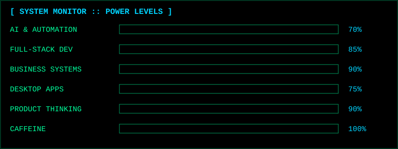
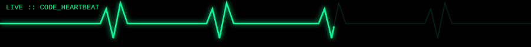

<div align="center">


<br/>


<br/>




</div>


## `> ACCESSING_USER_FILE...`

```bash
root@arhum:~$ whoami
muhammad_arhum

root@arhum:~$ cat identity.json
{
  "name"     : "Muhammad Arhum",
  "role"     : ["AI Engineer", "Full-Stack Developer"],
  "company"  : "AbyteSol (Founder & CEO)",
  "mission"  : "INNOVATE. CONNECT. GROW.",
  "location" : "Pakistan",
  "status"   : "Building. Shipping. Repeating."
}

root@arhum:~$ ./boot_sequence.sh
[  OK  ] Core identity loaded
[  OK  ] AI modules online
[  OK  ] Full-stack engine running
[  OK  ] Business systems synced
[  OK  ] Coffee supply ................. CRITICAL ☕
>> All systems operational. Welcome, visitor._
```

> **"Every great product starts with a question: What if we built it better?"**

Main **Muhammad Arhum** hoon: AI Engineer aur Full-Stack Developer. Mera focus useful digital products, intelligent systems aur business software banana hai. Pehle sketch se working product tak: architecture, code, mushkil problems aur polished experience.

Main **AbyteSol** ka **Founder & CEO** bhi hoon.

<div align="center">

```diff
+ INNOVATE.  CONNECT.  GROW.
```

</div>


<div align="center">



</div>

## `> ACTIVE_MODULES`

<table>
<tr>
<td width="50%" valign="top">

### 🤖 [ MODULE_01 ] Artificial Intelligence
```yaml
status: ACTIVE
focus:
  - AI-powered experiences
  - Intelligent automation
  - Tools that simplify complex work
```

</td>
<td width="50%" valign="top">

### 💻 [ MODULE_02 ] Full-Stack Engineering
```yaml
status: ACTIVE
focus:
  - End-to-end applications
  - Modern interfaces
  - Reliable, maintainable code
```

</td>
</tr>
<tr>
<td width="50%" valign="top">

### 🏢 [ MODULE_03 ] Business Systems
```yaml
status: ACTIVE
focus:
  - POS / CRM / ERP
  - Inventory & Billing
  - Business workflows
```

</td>
<td width="50%" valign="top">

### 🚀 [ MODULE_04 ] Product Development
```yaml
status: ACTIVE
focus:
  - Real-world problems
  - Practical features
  - Useful digital products
```

</td>
</tr>
</table>

## `> POWER_LEVELS`

<div align="center">



</div>


## `> TECH_ARSENAL`

<div align="center">


<br/><br/>


</div>

## `> MISSION_FILES`

<table>
<tr>
<td width="50%" valign="top">

### 🎟️ `restaurant_pos.exe`
Restaurant operations, order handling aur smooth daily workflows ke liye POS project.

```text
CLASSIFIED: LEVEL 2
FOCUS: POS · Orders · Restaurant Mgmt
```
<a href="https://github.com/MuhamadArhum?tab=repositories">▶ DECRYPT FILE</a>

</td>
<td width="50%" valign="top">

### 📦 `inventory_core.exe`
Inventory organize karne aur stock management asaan banane ka business software.

```text
CLASSIFIED: LEVEL 2
FOCUS: Inventory · Stock · Operations
```
<a href="https://github.com/MuhamadArhum?tab=repositories">▶ DECRYPT FILE</a>

</td>
</tr>
<tr>
<td width="50%" valign="top">

### 🧾 `billing_engine.exe`
Billing logic, transactions aur business processes ke gird software.

```text
CLASSIFIED: LEVEL 3
FOCUS: Billing · Transactions · Automation
```
<a href="https://github.com/MuhamadArhum?tab=repositories">▶ DECRYPT FILE</a>

</td>
<td width="50%" valign="top">

### 🏢 `crm_erp_suite.exe`
Customer management aur operational workflows behtar karne ke liye CRM & ERP.

```text
CLASSIFIED: LEVEL 3
FOCUS: CRM · ERP · Business Mgmt
```
<a href="https://github.com/MuhamadArhum?tab=repositories">▶ DECRYPT FILE</a>

</td>
</tr>
</table>


## `> LIVE_TELEMETRY`



<div align="center">


<br/><br/>


<br/>


</div>

## `> ACHIEVEMENTS_UNLOCKED`

<div align="center">


</div>

## `> CONTRIBUTION_SNAKE`

<div align="center">

<picture>
  <source media="(prefers-color-scheme: dark)" srcset="https://raw.githubusercontent.com/MuhamadArhum/MuhamadArhum/output/github-snake-dark.svg" />
  
</picture>

</div>


## `> ROADMAP.md`

```text
[x] Build real business software (POS, Inventory, Billing)
[x] Launch AbyteSol
[~] Expand AI-powered features into every product
[~] Ship more open projects on GitHub
[ ] Scale AbyteSol into a global tech brand
[ ] Keep learning. Keep shipping.
```

## `> SYSTEM_STATUS`

```ini
[CURRENT_FOCUS]   Building practical software and digital solutions
[INTERESTS]       AI, automation, intelligent applications
[BUILD_STACK]     Modern development tools and technologies
[APPROACH]        Understand the problem > Simplify the solution > Build with purpose
[AVAILABILITY]    Open to meaningful collaborations and exciting projects
[LOCATION]        Pakistan
```

## `> ESTABLISH_CONNECTION`

<div align="center">

<!-- YAHAN APNE LINKS LAGAYEIN: YOUR_LINKEDIN, YOUR_EMAIL, YOUR_WEBSITE -->
<a href="https://linkedin.com/in/YOUR_LINKEDIN"></a>
<a href="mailto:YOUR_EMAIL"></a>
<a href="https://YOUR_WEBSITE"></a>

<br/><br/>

### `> THINK BIGGER. BUILD SMARTER. KEEP SHIPPING._`

<a href="https://github.com/MuhamadArhum?tab=repositories">

</a>
<a href="https://github.com/MuhamadArhum">

</a>


**`[ INNOVATE. CONNECT. GROW. ]`**

<sub>`> Powered by curiosity, code, and coffee ☕ | END_OF_TRANSMISSION`</sub>

</div>
